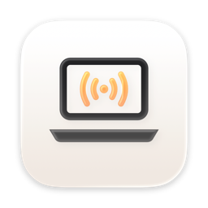

# Lid Sound

*[Po polsku niżej.](#po-polsku)*

A MacBook lid that creaks like an old door, or squeaks like a dry hinge, or makes any sound you
give it. Lid Sound sits in the menu bar and reads the lid angle sensor built into newer
MacBooks. While the lid moves, the chosen sound plays in a loop. It is loudest when the lid
moves slowly, like a real door, quieter when you swing it fast, and its pitch rises a little
with the speed.

Two sounds are built in, **Creak** and **Squeak**. The app makes both from numbers when it
starts, with no recordings. Your own sounds go in a folder: every audio file in it shows up in
the list. In Finder and the menu bar the app is named in the system's language: "Lid Sound",
"Dźwięk klapy", "Deckelklang"…

Tested on a MacBook Air with M5, macOS 27.

## Install

1. Download [Lid-Sound.zip](https://github.com/EnderNoch/Lid-Sound/raw/main/Lid-Sound.zip)
   and unzip it (double-click).
2. Drag `Lid Sound.app` into Applications and open it. A laptop icon appears in the menu bar.
   There is no window and no Dock icon.
3. First launch: the app is signed ad hoc, not by Apple, so macOS blocks it. Open System
   Settings → Privacy & Security, scroll down, click "Open Anyway" next to the app and confirm.
   After that it opens normally.

Requires macOS 26 or later on a Mac with Apple silicon and a lid angle sensor.

## Your own sounds

Click the menu bar icon, then **Open Sounds Folder**. It opens
`~/Library/Application Support/Lid Sound/Sounds`. Every WAV, M4A, MP3, AIFF, CAF or FLAC file
you put there becomes a sound in the list, named after the file. The list is read again each
time the panel opens. The sound plays in a loop for as long as the lid moves, so a short clip
that ends where it starts works best. A one-off noise works too, it just repeats.

## Good to know

- **Which Macs have the sensor.** The 16-inch MacBook Pro from 2019, MacBook Pros from 2021 on
  and MacBook Airs from M2 on. Without one, the panel says so and nothing plays.
- **The menu bar shows what you pick.** The icon, the angle as text, or the angle inside the
  icon, the way the battery shows its percentage. It is under Menu Bar in the panel.
- **It costs almost nothing at rest.** While the lid is still the app checks it 10 times a
  second and the audio is switched off. It goes up to 60 times a second only while the lid
  moves.
- **Opens at login.** It adds itself on the first launch. Switch it off in System Settings →
  General → Login Items, and it stays off.
- **The sensor isn't a public API.** Apple doesn't document it, so a future macOS may change it.
  [Sam Henri Gold](https://github.com/samhenrigold/LidAngleSensor) found how to read it.

## License

All rights reserved — see [LICENSE](LICENSE). You may download the finished app and use it on
your own computer. This is not open source: copying the code, distributing it other than by a
link to this repository, modifying it and training AI models on it require the author's
written permission.

Made by [EnderNoch](https://github.com/EnderNoch) (Atypical Maker) · part of
[Atypical Maker Mac Apps](https://github.com/EnderNoch/Atypical-Maker-Mac-Apps).

---

## Po polsku

Klapa MacBooka skrzypi jak stare drzwi, piszczy jak suchy zawias albo wydaje dowolny dźwięk,
jaki jej dasz. Dźwięk klapy siedzi na pasku menu i czyta czujnik kąta klapy wbudowany
w nowsze MacBooki. Gdy klapa się rusza, wybrany dźwięk gra w pętli. Najgłośniej gra przy
powolnym ruchu, jak prawdziwe drzwi, ciszej przy szybkim, a wraz z prędkością trochę rośnie
jego wysokość.

Wbudowane są dwa dźwięki: **Skrzypienie** i **Piszczenie**. Aplikacja tworzy oba z liczb przy
starcie, bez żadnych nagrań. Własne dźwięki wrzucasz do folderu: każdy plik dźwiękowy w nim
pojawia się na liście. W Finderze i na pasku menu aplikacja nazywa się w języku systemu:
„Dźwięk klapy”, „Lid Sound”, „Deckelklang”…

Testowane na MacBooku Air z M5, macOS 27.

### Instalacja

1. Pobierz [Lid-Sound.zip](https://github.com/EnderNoch/Lid-Sound/raw/main/Lid-Sound.zip)
   i rozpakuj go (dwuklik).
2. Przeciągnij `Lid Sound.app` do folderu Aplikacje i otwórz. Na pasku menu pojawi się ikona
   laptopa. Nie ma okna ani ikony w Docku.
3. Pierwsze uruchomienie: aplikacja jest podpisana ad-hoc, nie przez Apple, więc macOS ją
   zablokuje. Otwórz Ustawienia → Prywatność i ochrona, przewiń w dół i kliknij „Otwórz mimo
   to” przy aplikacji, potem potwierdź. Później otwiera się już normalnie.

Wymaga macOS 26 lub nowszego, Maca z procesorem Apple i czujnika kąta klapy.

### Własne dźwięki

Kliknij ikonę na pasku menu, potem **Otwórz folder z dźwiękami**. Otworzy się
`~/Library/Application Support/Lid Sound/Sounds`. Każdy plik WAV, M4A, MP3, AIFF, CAF albo
FLAC, który tam wrzucisz, staje się dźwiękiem na liście pod nazwą pliku. Lista odświeża się
przy każdym otwarciu panelu. Dźwięk gra w pętli, dopóki klapa się rusza, więc najlepiej
sprawdza się krótki fragment, który kończy się tak, jak zaczyna. Pojedynczy odgłos też
zadziała, tylko będzie się powtarzał.

### Dobrze wiedzieć

- **Które Maki mają czujnik.** 16-calowy MacBook Pro z 2019, MacBooki Pro od 2021 i MacBooki
  Air od M2. Bez czujnika panel o tym mówi i nic nie gra.
- **Pasek menu pokazuje to, co wybierzesz.** Ikonę, kąt jako tekst albo kąt w ikonie, tak jak
  bateria pokazuje procent. Ustawia się to w panelu, w polu Pasek menu.
- **W spoczynku prawie nic nie kosztuje.** Gdy klapa stoi, aplikacja sprawdza ją 10 razy na
  sekundę, a dźwięk jest wyłączony. Do 60 razy na sekundę przechodzi tylko w ruchu.
- **Otwiera się przy logowaniu.** Dodaje się sama przy pierwszym uruchomieniu. Wyłączysz to
  w Ustawieniach → Ogólne → Rzeczy otwierane podczas logowania i już tak zostanie.
- **Czujnik nie jest publicznym API.** Apple go nie opisuje, więc przyszły macOS może go
  zmienić. Sposób odczytu znalazł [Sam Henri Gold](https://github.com/samhenrigold/LidAngleSensor).
